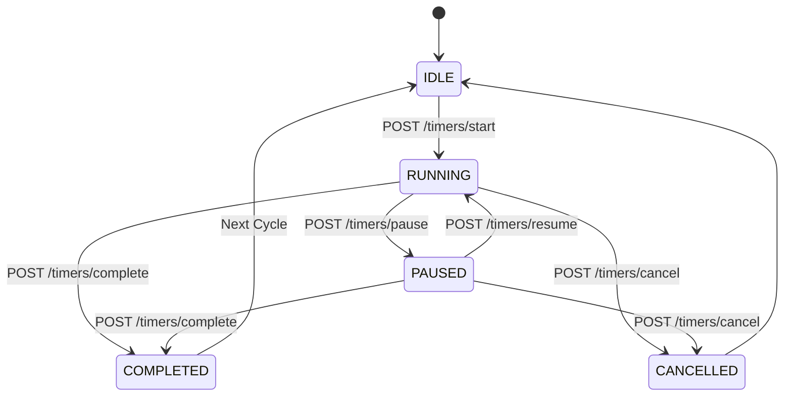

# StudySync — Frontend Integration & Architecture Guide

> **Audience**: Frontend Developers, Fullstack Integrators  
> **Status**: Verified Against Active Implementation  
> **Backend Version**: 1.0.0 (NestJS 11, Prisma 6, PostgreSQL, Socket.IO)

---

## 1. Quick Start & Local Backend Execution

### 1.1 Running the Backend Server
In the StudySync backend repository (`/home/asta/Projects/studysync/backend`), the development script is:
```bash
# Correct development command:
npm run start:dev
```
*(Note: If you run `npm run dev`, npm errors with `Missing script: "dev"`. Use `npm run start:dev` or `npm start`).*

### 1.2 Service URLs & Documentation
Once started, the backend exposes:
- **REST API Base URL**: `http://localhost:3000/api/v1`
- **Health Check**: `http://localhost:3000/api/v1/health`
- **Interactive Swagger UI**: `http://localhost:3000/api/docs`
- **Raw OpenAPI 3.0 JSON Schema**: `http://localhost:3000/api/docs-json`
- **Real-time WebSocket Gateway**: `ws://localhost:3000/collaboration`

### 1.3 CORS Configuration
The backend enables CORS with credentials support:
- **Default Allowed Origin**: `http://localhost:5173` (Vite's default dev server port).
- **Custom Origins**: Set `CORS_ORIGIN="http://localhost:5173,http://localhost:3001"` in `backend/.env`.
- **Credentials**: `credentials: true` is enabled to support cookies and Authorization headers.

---

## 2. Authentication Contract

### 2.1 Overview & Auth Modes
The backend supports two authentication verification modes controlled by `AUTH_MODE` in `.env`:
1. `AUTH_MODE=supabase` (Production & Staging):
   - Verifies standard Supabase JWT access tokens.
   - Tokens are validated either against `SUPABASE_JWT_SECRET` (HS256) or Supabase's public JWKS endpoint at `${SUPABASE_URL}/auth/v1/.well-known/jwks.json` (RS256/ES256).
2. `AUTH_MODE=dev` (Local Offline Development):
   - Signs and verifies symmetric HS256 tokens using `DEV_AUTH_SECRET`.
   - **Production Lockout**: If `NODE_ENV=production`, `AUTH_MODE=dev` is strictly rejected at application startup by class-validator guardrails.

---

### 2.2 Production Authentication (Supabase Client Flow)
In production, the frontend uses `@supabase/supabase-js` directly to manage user identity:

```typescript
import { createClient } from '@supabase/supabase-js';

export const supabase = createClient(
  import.meta.env.VITE_SUPABASE_URL,
  import.meta.env.VITE_SUPABASE_ANON_KEY
);

// 1. User Sign In
const { data, error } = await supabase.auth.signInWithPassword({
  email: 'user@example.com',
  password: 'Password123!',
});

// 2. Extract Access Token
const token = data.session?.access_token;

// 3. Listening to Token Refresh & Session Changes
supabase.auth.onAuthStateChange((event, session) => {
  if (session?.access_token) {
    apiClient.setToken(session.access_token);
  } else {
    apiClient.clearToken();
  }
});
```

#### Session Persistence & Logout
- **Persistence**: The Supabase client automatically handles session storage in `localStorage` and handles token refresh before expiry.
- **Header**: Attach the access token to all protected API calls:
  ```http
  Authorization: Bearer <session.access_token>
  ```
- **Logout Handling**:
  ```typescript
  await supabase.auth.signOut();
  ```
- **Expired Tokens (401)**: When a token expires, the backend returns `401 Unauthorized` (`"Invalid or expired authentication token"`). The frontend HTTP interceptor should catch 401s and trigger `supabase.auth.refreshSession()` or prompt the user to re-authenticate.

---

### 2.3 Development Authentication (`AUTH_MODE=dev`)
During local frontend development without live Supabase credentials:

1. **Generate a Development Token**:
   Run the CLI helper in `backend/`:
   ```bash
   npm run dev:token
   ```
   Or generate for a specific UUID and username:
   ```bash
   npm run dev:token -- "11111111-1111-4111-8111-111111111111" "alice@example.com" "alice_dev"
   ```
2. **First-Request Auto-Provisioning**:
   When the backend receives a development token for the first time, `AuthService.ensureProfile()` atomically creates a `Profile` record and default `UserPreference` record in the database.
3. **Limitations of Dev Tokens**:
   - Dev tokens are static JWTs valid for 7 days.
   - They cannot be refreshed via Supabase endpoints.
   - They must never be used in production environments.

---

## 3. Typed API Client Pattern

We recommend wrapping `fetch` or `axios` in an API client that handles token injection and parses RFC 7807 exceptions.

```typescript
// src/api/client.ts
export interface ApiErrorResponse {
  statusCode: number;
  error: string;
  message: string | string[];
  timestamp: string;
  path: string;
}

export class ApiClient {
  private baseUrl = import.meta.env.VITE_API_URL || 'http://localhost:3000/api/v1';
  private token: string | null = null;

  setToken(token: string) {
    this.token = token;
  }

  clearToken() {
    this.token = null;
  }

  async request<T>(endpoint: string, options: RequestInit = {}): Promise<T> {
    const headers: Record<string, string> = {
      'Content-Type': 'application/json',
      ...(options.headers as Record<string, string>),
    };

    if (this.token) {
      headers['Authorization'] = `Bearer ${this.token}`;
    }

    const response = await fetch(`${this.baseUrl}${endpoint}`, {
      ...options,
      headers,
    });

    if (!response.ok) {
      const errorPayload: ApiErrorResponse = await response.json().catch(() => ({
        statusCode: response.status,
        error: response.statusText,
        message: 'Unknown network error',
        timestamp: new Date().toISOString(),
        path: endpoint,
      }));
      throw errorPayload;
    }

    if (response.status === 204) {
      return {} as T;
    }

    return response.json();
  }

  get<T>(endpoint: string) {
    return this.request<T>(endpoint, { method: 'GET' });
  }

  post<T>(endpoint: string, body?: any) {
    return this.request<T>(endpoint, {
      method: 'POST',
      body: body ? JSON.stringify(body) : undefined,
    });
  }

  patch<T>(endpoint: string, body?: any) {
    return this.request<T>(endpoint, {
      method: 'PATCH',
      body: body ? JSON.stringify(body) : undefined,
    });
  }

  delete<T>(endpoint: string) {
    return this.request<T>(endpoint, { method: 'DELETE' });
  }
}

export const api = new ApiClient();
```

---

## 4. Authoritative Timer & Session Lifecycle

### 4.1 Authoritative Countdown Math
The backend operates as an authoritative state machine:
- When a timer starts, the server computes `expectedEndTime = now + targetDuration`.
- The browser countdown runs locally using `requestAnimationFrame` or `setInterval` for smooth 60fps animations, projecting remaining time from `expectedEndTime`.
- When the page reloads, call `GET /api/v1/timers/active`. The server returns:
  ```typescript
  authoritativeRemainingSeconds = Math.max(0, Math.round((expectedEndTime - Date.now()) / 1000));
  ```
- If `authoritativeRemainingSeconds === 0`, `isExpired: true` is returned.

---

### 4.2 Lifecycle Flow



1. **Start Timer**: `POST /api/v1/timers/start` with `{ timerModeId, phase, durationOverride }`.
2. **Pause**: `POST /api/v1/timers/pause`. Server captures remaining seconds and clears `expectedEndTime`.
3. **Resume**: `POST /api/v1/timers/resume`. Server sets `expectedEndTime = now + remainingSeconds`.
4. **Complete**: `POST /api/v1/timers/complete`.
   - Records focus duration into `StudySession`.
   - Increments `cycleCount` and `totalFocusSeconds`.
   - Computes `nextPhase`: If `cycleCount % longBreakInterval === 0`, recommends `LONG_BREAK`, otherwise `SHORT_BREAK`.
5. **Cancel**: `POST /api/v1/timers/cancel`.
   - If session was in `FOCUS` phase and elapsed time was >= 60 seconds, an `INTERRUPTED` study record is automatically logged with partial focus credit.

### 4.3 Supported vs Frontend-Local Timer Actions
- **Skip Phase**: Call `POST /timers/cancel` with `{ savePartialRecord: false }`, then immediately call `POST /timers/start` with the desired next `phase`.
- **Reset Phase**: Call `POST /timers/cancel` with `{ savePartialRecord: false }`, then call `POST /timers/start` with the same mode and phase.
- **Double-Counting Prevention**: The server computes actual duration as `targetDuration - remainingSeconds`. Tampering with client timers will never artificially inflate credited focus time.

---

## 5. Preferences, Taxonomy & Analytics

### 5.1 Preferences
Call `GET /api/v1/preferences` at app startup to hydrate:
- Theme (`'dark-glass'`, etc.)
- Timer face style (`'ring'`, `'digital'`, `'flip'`, `'minimal'`)
- Sound settings (`soundVolume: 0.0 - 1.0`, `soundEnabled: boolean`)
- Default mode ID (`defaultTimerModeId`)

Update settings on change using `PATCH /api/v1/preferences`.

### 5.2 Categories & Labels
- **Categories**: High-level domains (`name`, `color` hex regex `#RRGGBB`, `icon`).
- **Labels**: Sub-tags (`name`, `color`, optional `categoryId`).
- **Isolation**: Users can only see and attach their own categories and labels. Passing an ID owned by another user returns `403 Forbidden`.

### 5.3 Analytics & Charting Semantics
- `GET /api/v1/analytics/summary?startDate=...&endDate=...`:
  - `totalFocusSeconds`: Total credited focus seconds.
  - `completedSessionsCount`, `interruptedSessionsCount`, `totalSessionsCount`.
  - `averageSessionSeconds`.
  - `dailyBreakdown`: `[{ date: "YYYY-MM-DD", focusSeconds: 3600, sessionsCount: 2 }]`.
- **Streaks & Weekly Trends**:
  - The backend returns the raw daily breakdown array sorted chronologically.
  - Current streak, best streak, and percentage changes vs last week are calculated on the frontend by scanning consecutive dates in `dailyBreakdown`.

---

## 6. Real-Time Collaboration & Room Gateways

### 6.1 Socket.IO Connection & Authentication
- **Namespace**: `/collaboration`
- **Full URL**: `http://localhost:3000/collaboration`
- **Handshake Authentication**: Provide the Bearer token in `auth.token`:

```typescript
import { io, Socket } from 'socket.io-client';

export function connectCollaborationSocket(token: string): Socket {
  const socket = io('http://localhost:3000/collaboration', {
    auth: {
      token: `Bearer ${token}`,
    },
    transports: ['websocket', 'polling'],
  });

  socket.on('connect', () => {
    console.log('Connected to StudySync collaboration gateway:', socket.id);
  });

  socket.on('error', (err) => {
    console.error('Socket authorization error:', err);
  });

  return socket;
}
```

---

### 6.2 Client Socket Events
| Event | Direction | Payload | Description |
|---|---|---|---|
| `join_room` | Client ➔ Server | `{ "roomId": "room-uuid" }` | Subscribes socket to room broadcasts. User must be a room member. |
| `leave_room` | Client ➔ Server | `{ "roomId": "room-uuid" }` | Unsubscribes socket from room broadcasts. |

---

### 6.3 Server Broadcast Events
All room members who called `join_room` receive these broadcasts emitted to `room:<roomId>`:

| Event | Payload | Trigger |
|---|---|---|
| `timer:started` | `RoomStudySession` (with `authoritativeRemainingSeconds`) | Moderator started a room timer |
| `timer:paused` | `RoomStudySession` (with paused `remainingSeconds`) | Moderator paused the room timer |
| `timer:resumed` | `RoomStudySession` (with new `expectedEndTime`) | Moderator resumed the room timer |
| `timer:completed` | `{ roomSession, completedAt, participantCount }` | Moderator completed room timer |
| `timer:cancelled` | `{ roomId }` | Moderator cancelled room timer |
| `participant:joined` | `{ userId, user: { id, username, displayName }, joinedAt }` | Member clicked "Join Room Timer" |
| `participant:left` | `{ userId, leftAt, creditedSeconds }` | Member clicked "Leave Room Timer" |

---

### 6.4 Real-Time vs REST-Only Matrix

| Feature | Real-Time (Socket.IO) | REST API Required |
|---|---|---|
| **Room Timer State** | Yes (`timer:*` broadcasts) | `GET /api/v1/rooms/:roomId/timer` (initial hydration) |
| **Room Timer Controls** | No (controls via REST) | `POST /api/v1/rooms/:roomId/timer/start`, `/pause`, etc. |
| **Participant Presence** | Yes (`participant:joined`, `left`) | `POST /rooms/:roomId/timer/join`, `/leave` |
| **Room Invitations** | No | `POST /rooms/:roomId/invites`, `POST /invites/accept` |
| **Room Chat** | **No (REST-Only)** | `GET /rooms/:roomId/messages`, `POST .../messages` |

> [!NOTE]
> **Chat Real-Time Note**: Chat messaging is currently persisted and retrieved via REST (`/api/v1/rooms/:roomId/messages`). To show new messages, the frontend should either:
> 1. Poll with `before` / timestamp cursors every 3–5 seconds while in a room, or
> 2. Re-fetch upon user interaction.
> A future backend enhancement may add `message:created` to the Socket.IO gateway.

---

## 7. Frontend Environment Variables

Create `.env` in your frontend application (e.g. Vite or Next.js):

```env
# Backend REST Base URL
VITE_API_URL=http://localhost:3000/api/v1

# Backend Socket.IO Namespace URL
VITE_WS_URL=http://localhost:3000/collaboration

# Supabase Project Configuration (for production authentication)
VITE_SUPABASE_URL=https://your-project-ref.supabase.co
VITE_SUPABASE_ANON_KEY=your-supabase-public-anon-key
```
